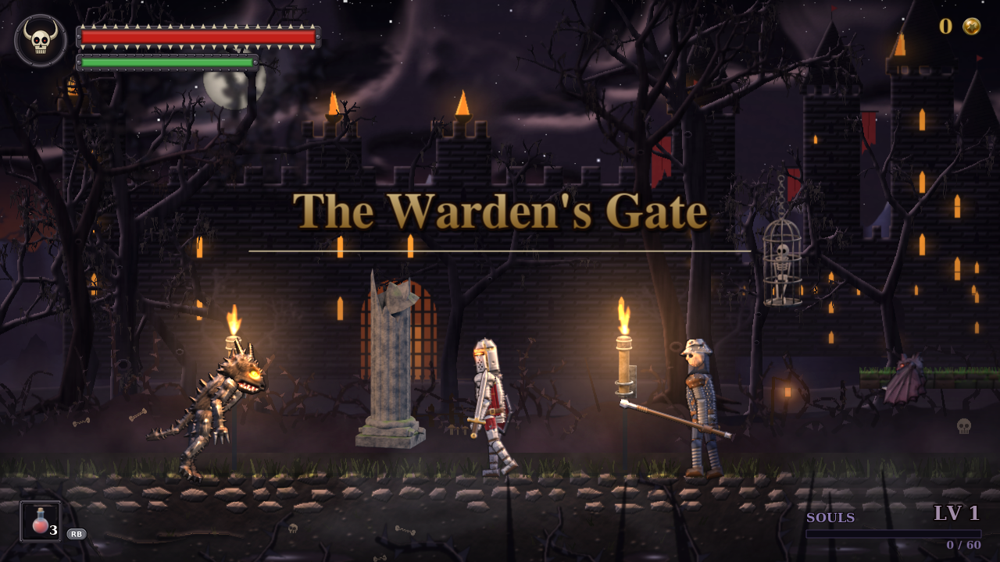

# Derelict

A side-on, cut-away survival shooter. Dropship *Kestrel 21* docks at the rear airlock of a drifting
multi-deck derelict (24 columns × 3 decks by default, generated from a seed as a spanning tree plus
loops). Sgt. Vance sweeps the ship room by room: doors, ladders and stairs join the rooms; vents are
for the things that live in the walls. Find the survivors, pull the ship's log from the bridge, get
everyone back to the Kestrel.

Dark and grimy on purpose: flashlight beams, fog of war that remembers what you have seen, a motion
tracker, speech-bubble barks, hit-stop, screen shake and acid blood.

Play it: **https://blatcho.com/games/sotb/** (any modern desktop browser; a gamepad is recommended).



## Controls

Controller first (Xbox-style, standard mapping). Keyboard and mouse work too.

| Action | Controller | Keyboard / mouse |
| --- | --- | --- |
| Move (speed from the stick) | Left stick / d-pad | WASD / arrows |
| Aim (360°, upper body turns) | Right stick | Mouse |
| Fire | RT | Left mouse / J |
| Shield | LT | Shift / right mouse |
| Jump | A | Space |
| Dodge back | B | K |
| Change weapon | Y | Q |
| Interact (rescue, take the log, board) | X | E |
| Reload | RB | R |
| Health kit | LB | H |
| Pause | Start | Esc |

With no stick aim the gun tracks the closest hostile on screen and fires by itself. Ladders are
climbed with up/down; stand on a hatch and press down to climb down.

**Demo mode** (title screen: Y on the pad, D on the keyboard, or `?demo=1` in the URL) plays the
mission by itself so the gameplay can be watched without a controller. Touching the keys, mouse or pad
takes control for a few seconds; it hands back when you stop.

URL options: `?seed=123` picks a ship, `?demo=1` starts the demo, `?play=1` skips the title,
`?pixel=0` renders at native resolution instead of 450 art lines, `?bloom=0` disables bloom,
`?det=1` makes a run deterministic for a seed (tests).

## Running locally

Everything is static: `index.html`, `src/derelict/`, `vendor/` (three.js, vendored, no CDN) and `assets/`.

```
npm start            # static server on http://localhost:8080
```

## Art pipeline

Every model is a Python script run in headless Blender: low-poly bmesh with vertex colours and baked
weathering (edge wear, grime, rust, scratches), rigidly skinned, exported as GLB with animation clips
and a meta JSON sidecar (bones, upper-body bones, clip loop/events/speeds, aim bone, muzzle).

```
pip install bpy                      # or point BLENDER at a Blender 4/5 binary
npm run models                       # tools/build-models.sh: marine, alien, survivor, kestrel, tiles, props
node tools/check-glb.mjs assets/models/*.glb
```

`tools/blender/common.py` holds the kit (PartMesh boxes/cylinders/wedges, weathering, rigs, semantic
pose rotations, clip keys, export). `tools/preview.html?model=marine&clip=run&t=0.25` shows any model
with the game's conventions (orthographic, 3/4 yaw, pixel scale).

Fonts and UI art: `python3 tools/gen_font.py`. Sound and music: `python3 tools/gen_audio.py`
(numpy synthesis to OGG). `npm run assets` runs both.

## Rendering

Orthographic three.js. Pixel mode renders 450 lines of art pixels and shows them at a whole-number
scale (`image-rendering: pixelated`). Lights are pooled (a fixed set of point lights plus the
flashlight spot live in the scene from the first frame, so programs never recompile), bloom runs at
art resolution, and the fog of war comes from visibility polygons cast through the tile grid into a
canvas texture: unseen is black, remembered is dim, visible is lit, the flashlight cone reaches
further. Characters turn to a 3/4 view; walk and run clips play at the speed travelled; reloads,
bursts and strikes play on the upper body only.

## Tests

```
npm test             # unit tests (generator + whole-ship walkability on 24 seeds), GLB checks, smoke test
```

The smoke test needs Playwright with Chromium; it boots the game headless, runs the deterministic demo
for 40 seconds of game time, checks the marine moved and fought without errors, and writes
`docs/smoke.png`.

## Deployment

`.github/workflows/deploy.yml` runs the unit tests and mirrors `index.html`, `.htaccess`, `src/`, `vendor/` and
`assets/` to the FTP host on every push to `main` (secrets `FTP_SERVER`, `FTP_USERNAME`,
`FTP_PASSWORD`).
